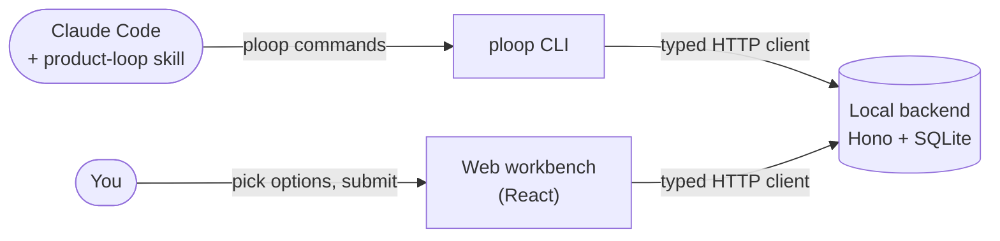

# product-loop

**Turn AI-written software into something you can hand to other people: five stages, with a before and an after screenshot for every fix.**

[中文说明 → README.zh-CN.md](README.zh-CN.md)

product-loop is a local tool for developers who build software with an AI coding agent (it is built around Claude Code). Once an agent has written a first version, the app usually runs, but it is full of small problems. product-loop runs a structured loop over it:

| Stage | What happens |
| --- | --- |
| **Think** (构思) | Agree on the product's *mainline*: a one-sentence press release, who it is for, the jobs to be done, scenarios, what not to build, delivery lines and risks. |
| **Use** (使用) | The agent walks every scenario through the real product the way a user would, using scripts, and fixes only the steps that break. |
| **Check** (检查) | The agent reviews each new or changed screen like a picky product manager and offers two or three options for each problem. |
| **Land** (落地) | The agreed changes get made. Every change is proven with a before and an after screenshot. |
| **Improve** (提升) | Step back and decide what to keep, add, remove or restructure. Then the next version starts. |

The agent does the finding and proposing. You do one thing: open the workbench, pick an option on each card, and submit.

## How it works



- **`ploop` CLI.** The agent drives the process through it: start a stage, validate and present a page, wait for your reply, then route each line of the reply to one of five places (mainline, decisions, queue, do now, no action). Every command ends with a "next step" the agent can run.
- **Local backend.** Hono with SQLite (better-sqlite3 and Drizzle). It enforces all business rules and owns storage. The CLI starts it on demand.
- **Web workbench.** React 19, TanStack Router and Query, React Aria Components and Tailwind CSS 4. One page per stage, with cards, text diffs and before/after images. A home view shows which of your projects is waiting on you.
- **Skill** (`skill/`). Tells the agent when to run which command and how to judge what it sees. The process itself lives in the CLI, so the skill text stays short.

## Repository layout

```
packages/
  model/     shared definitions: data schemas (Zod), validation rules, writing checks. Runs in Node and the browser
  backend/   local server: all business rules, exclusive owner of the database
  client/    typed HTTP client, plus a Node-only entry that starts the backend
  cli/       the ploop command (Commander)
  web/       the workbench (React)
scripts/     build, end-to-end "use" scenarios, performance check
skill/       the Claude Code skill
docs/        phase plans, maintenance notes, generated command reference, ADRs
spikes/      code that validated key libraries before the build started
tools/legacy/  one-off export and parity tools for migrating from the earlier script-based version
design/      the product's own mainline and early palette experiments
```

Dependencies only point one way. `model` depends on nothing. `backend` and `client` depend only on `model`. `cli` and `web` depend on `client` and `model`, never on `backend`. Inside `backend`, `core` never imports `http`; Biome's `noRestrictedImports` enforces that.

## Engineering

- TypeScript everywhere, with `strict`, `noUncheckedIndexedAccess` and `erasableSyntaxOnly`. Node runs the sources directly through type stripping.
- `pnpm check` runs Biome, the type checker, knip (unused files, exports and dependencies) and Vitest. About 5,700 tests in 264 files.
- `pnpm use` builds the app and drives it end to end. There is one script per scenario in the product's own mainline (S1 to S37).
- The TypeScript rewrite was checked against the earlier Python and JavaScript scripts. Their outputs were exported as fixtures, and the tests compare the new code with them: byte for byte for the text diff, and line by line for the writing checks and reply parsing. Intentional differences are listed by ID in the tests.
- Installs are versioned under `~/.product-loop/app/<version>/`. A database snapshot is taken before any schema migration, and `ploop setup --version <old>` switches back to an installed version.
- One version number covers the CLI, backend, workbench and skill.

## Getting started

Requirements:

- macOS. It has only been used on macOS; the Time Machine check and login autostart are macOS only.
- Node 24.12 or later.
- pnpm 11. Corepack picks the pinned version from `package.json`.
- Claude Code.

Install the command and the skill:

```sh
git clone https://github.com/xingqiux/product-loop.git
cd product-loop
pnpm install
pnpm ploop:setup        # build, install to ~/.product-loop/app/<version>/, link ~/.local/bin/ploop

mkdir -p ~/.claude/skills/product-loop
cp -R skill/. ~/.claude/skills/product-loop/
```

If `~/.local/bin` is not on your `PATH`, `ploop:setup` prints a warning; add `export PATH="$HOME/.local/bin:$PATH"` to your shell profile. Run `ploop --version` in a new terminal to confirm.

Start in a project: open Claude Code in the project root and ask it to use the product loop (「用产品循环」). Or run it yourself:

```sh
ploop init --repo 自己的    # your own repo; use --repo 共用的 for a shared repo
ploop                      # where you are and what to do next
ploop open                 # open the workbench in the browser
```

Development commands:

| Command | What it does |
| --- | --- |
| `pnpm check` | Lint, type check, knip and tests; stops at the first failure |
| `pnpm test` | Unit and integration tests (Vitest) |
| `pnpm use` | Build, then run the end-to-end scenarios |
| `pnpm build` | Bundle backend, CLI and workbench into `dist/app/` |
| `pnpm fix` | Format and apply safe fixes with Biome |

## Language

The workbench, CLI output, skill and docs are written in Simplified Chinese. Code identifiers are English. Some CLI arguments are Chinese words, such as stage names (`ploop round start 构思`) and `--repo 自己的`. The full command reference is generated from the CLI's own help: [`docs/命令参考.md`](docs/命令参考.md).

## Status

- Phase 1 (CLI and backend), phase 2 (workbench) and phase 3 (multi-project) are done. An MCP server was considered and dropped.
- This is a personal project, used on real projects and tested only on macOS.
- The design documents that the docs refer to (「01 架构」 and others) are kept outside this repository.
- This public repository starts from a clean snapshot without the earlier commit history. Fixture data that came from private projects has been removed, and the remaining project names were replaced.
